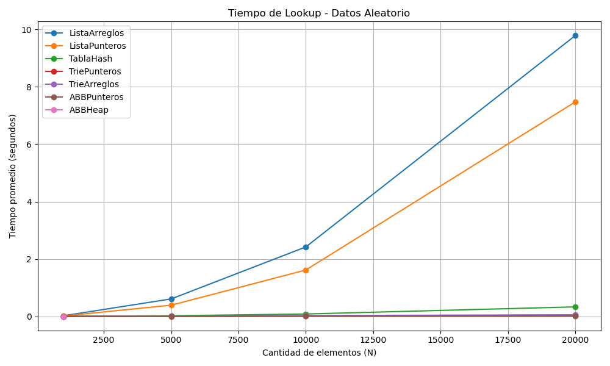
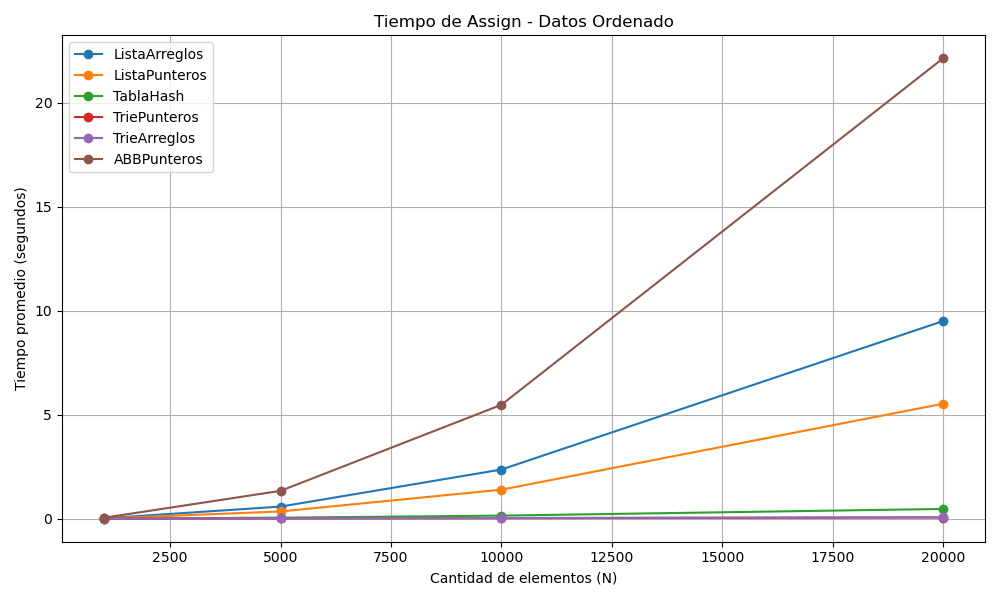
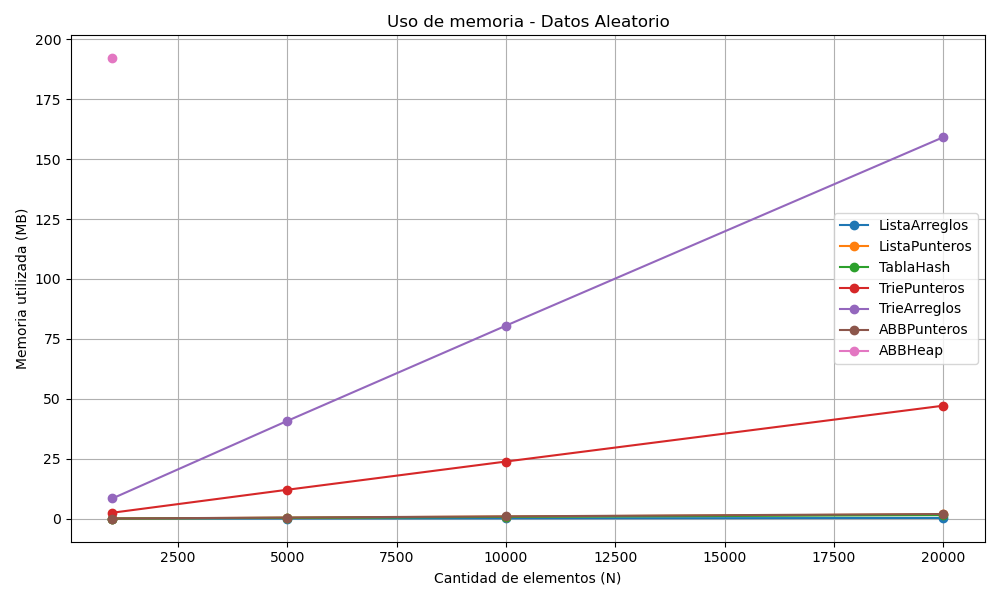
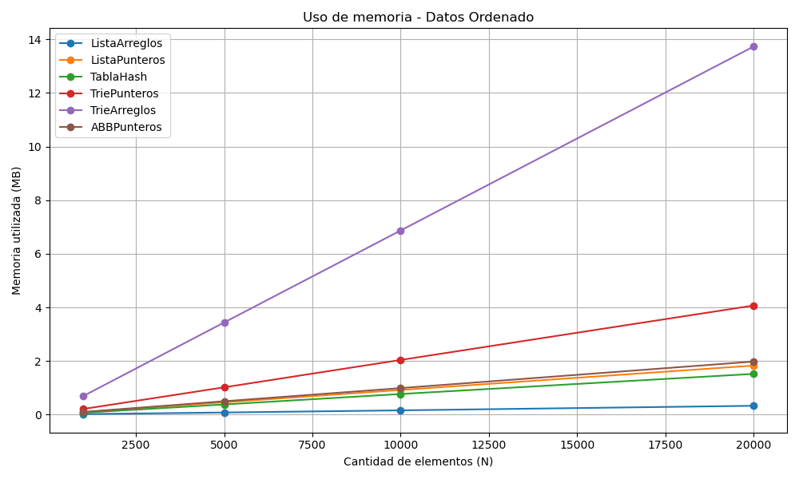

**Sebastián Chaves Durán**

**C12120**

**Jordan Antonio Sánchez Tencio**

**C4J811**

**Tarea Programada #1**

**Análisis de Rendimiento**

**1\. Metodología de Pruebas**

Para garantizar la validez estadística de los resultados y minimizar las fluctuaciones causadas por los procesos de fondo del sistema operativo, el análisis empírico se diseñó bajo un entorno de evaluación automatizado.

**Hardware utilizado para las pruebas:**

- Procesador: Intel i7 14700K.
- RAM: 32 GB DDR5 6400 MHz.
- Almacenamiento: SSD NVMe PCIe 4.0 4TB 7,300 MB/s
- Sistema Operativo: Windows 11 Pro.
- Versión Python: Python 3.14.5.

**Parámetros de Medición:**

- **Tamaños de N:** Se evaluaron conjuntos de N = {1000, 5000, 10000, 20000} llaves.
- **Tipos de Datos:** Para medir el impacto estructural, se probaron dos escenarios:
    1.  **Aleatorio:** Llaves alfanuméricas generadas sin patrón, buscando una distribución normal.
    2.  **Ordenado:** Llaves generadas en orden alfabético estricto (ej. llave00001, llave00002), lo cual representa el peor caso teórico para estructuras no balanceadas.
- **Corridas:** Cada combinación de Estructura, N y Tipo se ejecutó 10 veces consecutivas, instanciando datos nuevos en cada corrida. Los tiempos reportados (en segundos) representan el promedio de las 10 corridas. Para el uso de memoria (en MB), se reportó el pico máximo histórico capturado mediante la librería nativa de rastreo de memoria de Python.

**2\. Cuadros de Resultados (Promedio de 10 Corridas)**

**Lista Ordenada por Arreglos**

|     |     |     |     |     |     |     |     |
| --- | --- | --- | --- | --- | --- | --- | --- |
| **N** | **Tipo** | **Assign (s)** | **Lookup (s)** | **Print (s)** | **Unassign (s)** | **Done (s)** | **Memoria (MB)** |
| 1000 | Aleatorio | 0.0101 | 0.0235 | 0.0022 | 0.0084 | 0.0000 | 0.02 |
| 1000 | Ordenado | 0.0213 | 0.0255 | 0.0022 | 0.0002 | 0.0000 | 0.02 |
| 5000 | Aleatorio | 0.2843 | 0.6093 | 0.0109 | 0.2296 | 0.0000 | 0.08 |
| 5000 | Ordenado | 0.5842 | 0.6413 | 0.0108 | 0.0363 | 0.0000 | 0.08 |
| 10000 | Aleatorio | 1.1488 | 2.4216 | 0.0213 | 0.9220 | 0.0000 | 0.16 |
| 10000 | Ordenado | 2.3657 | 2.5738 | 0.0216 | 0.1470 | 0.0000 | 0.16 |
| 20000 | Aleatorio | 4.6923 | 9.7837 | 0.0436 | 3.7148 | 0.0000 | 0.33 |
| 20000 | Ordenado | 9.4988 | 10.1629 | 0.0426 | 0.5938 | 0.0000 | 0.33 |

**Lista Ordenada por Punteros**

|     |     |     |     |     |     |     |     |
| --- | --- | --- | --- | --- | --- | --- | --- |
| **N** | **Tipo** | **Assign (s)** | **Lookup (s)** | **Print (s)** | **Unassign (s)** | **Done (s)** | **Memoria (MB)** |
| 1000 | Aleatorio | 0.0070 | 0.0155 | 0.0021 | 0.0055 | 0.0000 | 0.09 |
| 1000 | Ordenado | 0.0145 | 0.0176 | 0.0021 | 0.0000 | 0.0000 | 0.09 |
| 5000 | Aleatorio | 0.1690 | 0.3914 | 0.0106 | 0.1379 | 0.0000 | 0.46 |
| 5000 | Ordenado | 0.3515 | 0.4286 | 0.0106 | 0.0002 | 0.0000 | 0.46 |
| 10000 | Aleatorio | 0.6933 | 1.6173 | 0.0217 | 0.5655 | 0.0000 | 0.92 |
| 10000 | Ordenado | 1.3975 | 1.7069 | 0.0215 | 0.0005 | 0.0000 | 0.92 |
| 20000 | Aleatorio | 2.9498 | 7.4720 | 0.0429 | 2.4409 | 0.0000 | 1.83 |
| 20000 | Ordenado | 5.5253 | 6.6884 | 0.0416 | 0.0010 | 0.0000 | 1.83 |

**Tabla Hash Abierta**

|     |     |     |     |     |     |     |     |
| --- | --- | --- | --- | --- | --- | --- | --- |
| **N** | **Tipo** | **Assign (s)** | **Lookup (s)** | **Print (s)** | **Unassign (s)** | **Done (s)** | **Memoria (MB)** |
| 1000 | Aleatorio | 0.0067 | 0.0016 | 0.0022 | 0.0009 | 0.0000 | 0.08 |
| 1000 | Ordenado | 0.0067 | 0.0016 | 0.0021 | 0.0008 | 0.0000 | 0.07 |
| 5000 | Aleatorio | 0.0506 | 0.0231 | 0.0107 | 0.0039 | 0.0000 | 0.38 |
| 5000 | Ordenado | 0.0528 | 0.0252 | 0.0108 | 0.0039 | 0.0000 | 0.38 |
| 10000 | Aleatorio | 0.1425 | 0.0848 | 0.0215 | 0.0081 | 0.0000 | 0.77 |
| 10000 | Ordenado | 0.1508 | 0.0932 | 0.0212 | 0.0080 | 0.0000 | 0.77 |
| 20000 | Aleatorio | 0.4555 | 0.3332 | 0.0429 | 0.0375 | 0.0000 | 1.53 |
| 20000 | Ordenado | 0.4722 | 0.3429 | 0.0422 | 0.0370 | 0.0000 | 1.52 |

**Trie por Punteros**

|     |     |     |     |     |     |     |     |
| --- | --- | --- | --- | --- | --- | --- | --- |
| **N** | **Tipo** | **Assign (s)** | **Lookup (s)** | **Print (s)** | **Unassign (s)** | **Done (s)** | **Memoria (MB)** |
| 1000 | Aleatorio | 0.0139 | 0.0013 | 0.0044 | 0.0026 | 0.0000 | 2.52 |
| 1000 | Ordenado | 0.0027 | 0.0010 | 0.0033 | 0.0018 | 0.0000 | 0.21 |
| 5000 | Aleatorio | 0.0760 | 0.0078 | 0.0235 | 0.0141 | 0.0000 | 12.10 |
| 5000 | Ordenado | 0.0139 | 0.0051 | 0.0167 | 0.0093 | 0.0000 | 1.02 |
| 10000 | Aleatorio | 0.1684 | 0.0167 | 0.0496 | 0.0301 | 0.0000 | 23.87 |
| 10000 | Ordenado | 0.0286 | 0.0108 | 0.0349 | 0.0190 | 0.0000 | 2.04 |
| 20000 | Aleatorio | 0.4225 | 0.0365 | 0.0989 | 0.0642 | 0.0000 | 47.16 |
| 20000 | Ordenado | 0.0580 | 0.0218 | 0.0692 | 0.0380 | 0.0000 | 4.07 |

**Trie por Arreglos**

|     |     |     |     |     |     |     |     |
| --- | --- | --- | --- | --- | --- | --- | --- |
| **N** | **Tipo** | **Assign (s)** | **Lookup (s)** | **Print (s)** | **Unassign (s)** | **Done (s)** | **Memoria (MB)** |
| 1000 | Aleatorio | 0.0188 | 0.0023 | 0.0248 | 0.0091 | 0.0000 | 8.48 |
| 1000 | Ordenado | 0.0036 | 0.0017 | 0.0056 | 0.0034 | 0.0000 | 0.69 |
| 5000 | Aleatorio | 0.1112 | 0.0138 | 0.1248 | 0.0479 | 0.0000 | 40.83 |
| 5000 | Ordenado | 0.0181 | 0.0085 | 0.0285 | 0.0176 | 0.0000 | 3.44 |
| 10000 | Aleatorio | 0.2364 | 0.0284 | 0.2489 | 0.0986 | 0.0000 | 80.55 |
| 10000 | Ordenado | 0.0375 | 0.0171 | 0.0567 | 0.0358 | 0.0000 | 6.87 |
| 20000 | Aleatorio | 0.5069 | 0.0579 | 0.4933 | 0.1940 | 0.0000 | 159.15 |
| 20000 | Ordenado | 0.0756 | 0.0342 | 0.1123 | 0.0707 | 0.0000 | 13.73 |

**ABB por Punteros**

|     |     |     |     |     |     |     |     |
| --- | --- | --- | --- | --- | --- | --- | --- |
| **N** | **Tipo** | **Assign (s)** | **Lookup (s)** | **Print (s)** | **Unassign (s)** | **Done (s)** | **Memoria (MB)** |
| 1000 | Aleatorio | 0.0011 | 0.0005 | 0.0022 | 0.0007 | 0.0000 | 0.10 |
| 1000 | Ordenado | 0.0485 | 0.0365 | 0.0023 | 0.0001 | 0.0000 | 0.10 |
| 5000 | Aleatorio | 0.0064 | 0.0035 | 0.0110 | 0.0049 | 0.0000 | 0.50 |
| 5000 | Ordenado | 1.3420 | 1.0560 | 0.0114 | 0.0006 | 0.0000 | 0.50 |
| 10000 | Aleatorio | 0.0137 | 0.0075 | 0.0225 | 0.0106 | 0.0000 | 0.99 |
| 10000 | Ordenado | 5.4769 | 4.3930 | 0.0227 | 0.0012 | 0.0000 | 0.99 |
| 20000 | Aleatorio | 0.0291 | 0.0169 | 0.0453 | 0.0236 | 0.0000 | 1.98 |
| 20000 | Ordenado | 22.1235 | 17.4890 | 0.0452 | 0.0023 | 0.0000 | 1.98 |

**ABB por Arreglos (Vector Heap)**

|     |     |     |     |     |     |     |     |
| --- | --- | --- | --- | --- | --- | --- | --- |
| **N** | **Tipo** | **Assign (s)** | **Lookup (s)** | **Print (s)** | **Unassign (s)** | **Done (s)** | **Memoria (MB)** |
| 1000 | Aleatorio | 0.0399 | 0.0010 | 0.0406 | 0.0018 | 0.0118 | 192.00 |
| 1000 | Ordenado | Error | Error | Error | Error | Error | Error |
| 5000 | Aleatorio | Error | Error | Error | Error | Error | Error |
| 5000 | Ordenado | Error | Error | Error | Error | Error | Error |
| 10000 | Aleatorio | Error | Error | Error | Error | Error | Error |
| 10000 | Ordenado | Error | Error | Error | Error | Error | Error |
| 20000 | Aleatorio | Error | Error | Error | Error | Error | Error |
| 20000 | Ordenado | Error | Error | Error | Error | Error | Error |

**3\. Análisis de Tiempos de Ejecución (Complejidad Temporal)**

Los resultados confirman el comportamiento teórico de cada estructura de datos.

**3.1. Degradación Lineal en Listas Ordenadas**

Las implementaciones basadas en Listas (tanto Arreglos como Punteros) fueron las menos eficientes en tiempo. Al pasar de N=1000 a N=20000, el tiempo de inserción (Assign) en la Lista por Arreglos pasó de 0.010s a 4.69s. Esto se debe a la complejidad O(N) requerida para desplazar los elementos en el arreglo contiguo y mantener el ordenamiento en cada inserción.

**3.2. Estabilidad de la Tabla Hash**

La Tabla Hash Abierta demostró un excelente rendimiento constante. Para N=20000, su tiempo de Lookup fue de apenas 0.33s. Esto confirma que una buena función de dispersión permite acercarse al tiempo teórico esperado de O(1) en operaciones mutables y de acceso, siendo inmune al estado de ordenamiento inicial de los datos.

**3.3. Eficiencia Constante en los Tries O(L)**

Las dos implementaciones de Tries registraron los mejores tiempos de búsqueda entre todas las demás. En el Trie por Punteros, el Lookup para N=20000 aleatorio tomó solo 0.036s. Esto corrobora que el tiempo en un Trie no depende de la cantidad de datos almacenados (N), sino de la longitud de la llave (L). Al estar las llaves limitadas a 20 caracteres por el Modelo Función, el acceso opera prácticamente en tiempo O(1).

**3.4. El Impacto Crítico del Desbalanceo en ABB**

El Árbol Binario de Búsqueda (ABB) por punteros muestra una dualidad entre el caso promedio y el peor caso:

- **Escenario Aleatorio (O(log N)):** Tiempos sobresalientes. En N=20000, buscar tardó apenas 0.016 segundos. Al ingresar aleatoriamente, el árbol se balancea de forma natural, minimizando la altura.
- **Escenario Ordenado (O(N)):** Hubo una caída gigantesca. Las llaves ingresadas en orden alfabético hacen que cada nodo se inserte como el hijo derecho del anterior, degenerando el árbol en una lista simplemente enlazada. El tiempo de Assign se disparó a 22.1 segundos y el de Lookup a 17.4 segundos. Muestra la necesidad de auto balanceo en aplicaciones de la vida real.

**4\. Análisis de Uso de Espacio (Complejidad Espacial)**

Las mediciones de memoria evidencian “Trade-offs" entre velocidad y RAM.

- **Estructuras más eficientes:** Las Listas y la Tabla Hash consumieron menos de 2 MB para almacenar 20,000 datos, siendo las más eficientes espacialmente. El ABB por Punteros también fue conservador, utilizando aproximadamente 1.98 MB.
- **El costo del Trie por Arreglos:** Como se predijo teóricamente en una entrega anterior, el Trie por arreglos consume cantidades masivas de memoria. Al reservar un arreglo estático de 62 posiciones por cada nodo (independientemente de si se usan o no), para N=20000 (aleatorio) la estructura consumió 159.15 MB. En contraparte, su versión por punteros utilizó solo 47.16 MB, demostrando que las listas enlazadas dinámicas evitan el desperdicio de referencias nulas.

- **El caso de los prefijos compartidos:** Es muy interesante notar que el consumo de memoria en los Tries disminuyó radicalmente con los datos ordenados (pasando de 47 MB a solo 4 MB). Investigando se descubre que esto sucede gracias a que el prefijo queda casi igual en la mayoría lo que hace que reutilice los nodos. Es altamente eficiente para datos similares léxicamente.

**5\. Errores Encontrados: Colapso del ABB por Vector Heap**

Durante el análisis se observó una limitación importante en la implementación del Árbol Binario de Búsqueda por Arreglos (Vector Heap).

Para tamaños pequeños la estructura funcionó correctamente. Pero, al aumentar la cantidad de elementos, el consumo de memoria creció rápidamente debido a la forma en que los nodos se almacenan dentro del vector. Como consecuencia, en varias pruebas generó la excepción MemoryError.

Con datos aleatorios fue posible completar algunas corridas aisladas, aunque con un consumo de memoria extremadamente alto. Ejemplo:

| **N** | **Assign (s)** | **Lookup (s)** | **Memoria (MB)** |
| --- | --- | --- | --- |
| 10000 | 81.879326 | 0.021349 | 49152.435658 |

En esta ejecución la estructura logró finalizar, pero utilizó aproximadamente 49 GB de memoria. Dado que el equipo utilizado cuenta únicamente con 32 GB de RAM, es probable que el sistema operativo recurriera al SSD NVMe (paginación), provocando un aumento considerable en los tiempos de ejecución.

Ya al hacer el conjunto completo de pruebas (10 corridas por caso), la implementación presentó MemoryError para tamaños de 5000 elementos o superiores. Además, cuando las llaves se insertaron en orden, el error apareció incluso antes con 1000 elementos, probablemente por el desbalance extremo que se genera en el árbol y al gran desperdicio de espacio producido por la representación heap.

**Explicación teórica del fallo:**

Esta limitación no se debe a un error de programación, sino a una deficiencia de diseño matemático subyacente de la estructura. Al utilizar una correspondencia posicional estricta donde el hijo derecho se aloja en el índice 2i + 1, el arreglo debe poseer una longitud total equivalente al índice más alto requerido.

En teoría, la posición requerida crece exponencialmente (aproximadamente siguiendo 2^h), haciendo imposible almacenar árboles muy desbalanceados mediante esta representación. El intérprete de Python intenta instanciar un bloque de memoria contigua nula de un tamaño superior a la capacidad física de procesamiento del sistema, haciendo que se cierre el programa.

Esto demuestra empíricamente que representar un árbol binario no balanceado sobre un arreglo unidimensional secuencial no es posible para cualquier entorno “normal”.

**6\. Conclusiones**

Como conclusión general, los resultados obtenidos muestran que la Tabla Hash Abierta fue la estructura más balanceada para implementar el Modelo Función, ya que logró tiempos de inserción y búsqueda muy bajos sin requerir grandes cantidades de memoria.

Los Tries fueron las estructuras más rápidas para las operaciones de búsqueda debido a que su tiempo depende principalmente de la longitud de la llave y no de la cantidad de elementos almacenados; sin embargo, la implementación por arreglos presentó un consumo de memoria muy elevado en comparación con la versión por punteros.

Por otra parte, el análisis también evidenció las limitaciones de los Árboles Binarios de Búsqueda cuando no se encuentran balanceados. En el caso del ABB por punteros se observaron degradaciones importantes en el tiempo de ejecución al utilizar datos ordenados, mientras que el ABB por Vector Heap llegó incluso a producir errores de memoria debido al crecimiento excesivo del vector requerido para representar árboles altamente desbalanceados.

En conclusión final, los resultados permiten concluir que la elección de la estructura de datos adecuada depende tanto del tamaño de los datos como de las restricciones de tiempo y memoria presentes en el problema.
